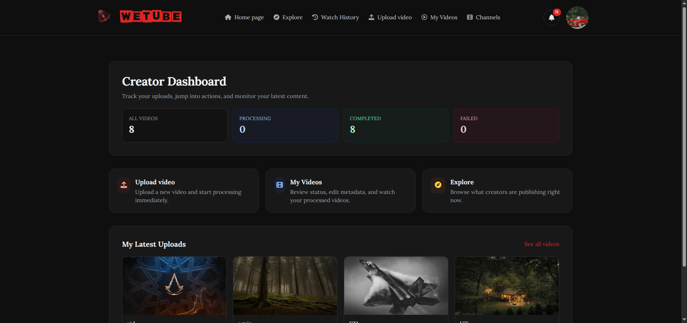
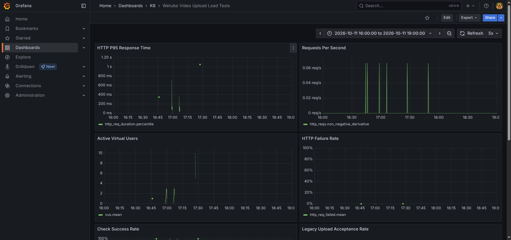
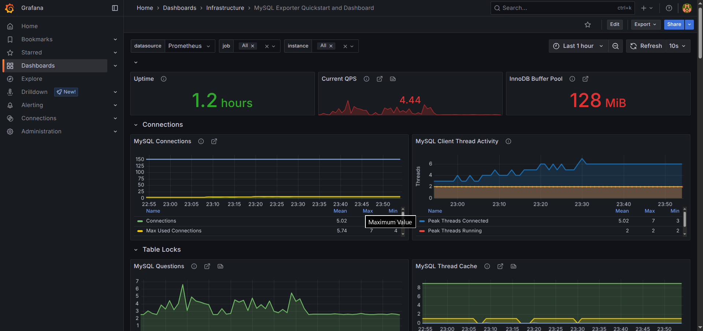

# 🎬 Wetube

**A Laravel video platform built to explore asynchronous media processing, queue-backed workloads, and measurable backend performance.**

Laravel 12 · PHP 8.2+ · MySQL · Redis · FFmpeg · Cloudinary · Docker Compose · k6 · InfluxDB · Prometheus · Grafana

## Overview

Wetube is a YouTube-inspired video platform and backend engineering case study. Its central question is: **what changes when expensive video-processing work is moved out of the HTTP request and into background jobs?**

The project provides two upload paths:

- **Legacy:** `POST /videos`
- **Optimized:** `POST /videos/optimized`

The legacy path uses the traditional upload/FFmpeg processing flow. The optimized path accepts the upload and dispatches processing work to Redis-backed queues, where workers process and finalize videos asynchronously.

## 🎬 Demo and screenshots

- **Silent application walkthrough:** [▶ Watch the demo (MP4)](backend/docs/demo.mp4)

### Application preview



### k6 upload load-test dashboard



### MySQL infrastructure monitoring



These screenshots highlight the application, request-level load-test results, and populated database monitoring panels. The separate Laravel application dashboard screenshot is not featured here because it contains empty panels; keep the README focused on evidence that is useful and readable.

## ✨ Highlights

- User authentication and channel pages
- Video uploads, processing-status tracking, and playback
- Legacy and queue-backed optimized upload paths
- FFmpeg processing and Cloudinary media storage
- Redis queues and dedicated background workers
- Configurable AI-assisted moderation integration
- Likes, comments, reports, notifications, and watch history
- Docker Compose development environment
- k6 upload scenarios with InfluxDB result storage
- Grafana dashboards and Prometheus application/infrastructure metrics
- MySQL, Redis, and container monitoring

## 🏗️ Architecture

```text
Browser ──► Nginx ──► Laravel / PHP ──► MySQL
                            │
                            ├── Legacy upload ──► processing flow
                            │
                            └── Optimized upload ──► Redis queue
                                                       │
                                                       ▼
                                                 Queue workers
                                                       │
                                         FFmpeg / moderation / Cloudinary
                                                       │
                                                       ▼
                                                Finalize video

Load testing:      k6 ──► InfluxDB ──► Grafana
App / infrastructure metrics: Laravel + exporters ──► Prometheus ──► Grafana
```

### Main components

| Component            | Responsibility                                                  |
| -------------------- | --------------------------------------------------------------- |
| Laravel / PHP        | Web application, authentication, validation, and business logic |
| MySQL                | Persistent application records                                  |
| Redis                | Queue backend and caching                                       |
| Queue workers        | Background video-processing jobs                                |
| FFmpeg               | Media processing                                                |
| Cloudinary           | Video and image storage/delivery                                |
| k6                   | HTTP load generation and request-level measurements             |
| InfluxDB             | Stores k6 metrics                                               |
| Prometheus           | Collects application and infrastructure metrics                 |
| Grafana              | Visualizes load-test and monitoring data                        |
| cAdvisor / exporters | Container, MySQL, and Redis telemetry                           |

## 📊 Recorded batch-processing results

These results measure the **time for an entire upload batch to reach completed state**, not just how quickly the HTTP endpoint responds. After each run, the video records were checked in MySQL.

| Recorded run                                | Submitted |        Completed | Batch elapsed time |
| ------------------------------------------- | --------: | ---------------: | -----------------: |
| Legacy upload (`POST /videos`)              |         5 |   **5/5 (100%)** |  **24 min 13 sec** |
| Optimized upload (`POST /videos/optimized`) |        10 | **10/10 (100%)** |  **11 min 04 sec** |

The legacy batch ran from the first video record created at **14:49:00** to the last video record updated at **15:13:13**. The optimized batch ran from **14:27:27** to **14:38:31** on October 11, 2026.

**Observed outcome:** in these local runs, the optimized run completed twice as many videos in less than half the elapsed time of the legacy run.

**How to interpret this:** elapsed time was calculated from the earliest `created_at` to the latest `updated_at` among the videos in each batch, with every video confirmed completed. This is a database-timestamp estimate of the batch window, not a dedicated external stopwatch measurement. These are single local runs with different batch sizes, so they are useful as a recorded project result but not a statistically controlled benchmark or a universal performance guarantee.

**Benchmark caveat:** Hugging Face moderation was disabled through `HUGGING_FACE_MODERATION_ENABLED=false` during these measured runs because the external inference account had no remaining credits. The results therefore do not measure moderation-enabled performance. Supply a valid, funded API configuration before evaluating that integration.

## Technology stack

- **Backend:** Laravel 12, PHP 8.2+
- **UI:** Livewire, Tailwind CSS, Vite
- **Data and jobs:** MySQL, Redis
- **Media:** FFmpeg, Cloudinary
- **Infrastructure:** Docker Compose, Nginx
- **Testing and observability:** Pest, k6, InfluxDB, Prometheus, Grafana, cAdvisor, MySQL Exporter, Redis Exporter

## Project layout

```text
Wetube/
├── backend/
│   ├── app/                 # Laravel application code
│   ├── docs/                # Demo video and portfolio screenshots
│   │   ├── app-preview.png
│   │   ├── grafana-app.png
│   │   ├── grafana-k6.png
│   │   ├── grafana-sql.png
│   │   └── demo.mp4
│   ├── routes/
│   └── tests/
├── docker/
│   ├── grafana/             # Provisioning and dashboards
│   ├── nginx/
│   ├── php/
│   ├── prometheus/
│   ├── redis/
│   └── mysql-exporter/
├── k6/
│   ├── lib/
│   ├── ffmpeg-upload-test.js
│   ├── optimized-upload-test.js
│   └── README.md
├── docker-compose.yml
├── .env.example
└── README.md
```

## 🚀 Run locally

### Prerequisites

- Docker Engine and Docker Compose
- A Cloudinary account and upload presets for the media used by the app
- A Hugging Face API token with available inference credits if you want to run AI moderation

### 1. Configure environment files

From the repository root:

```bash
cp .env.example .env
cp backend/.env.example backend/.env
```

Update the root `.env` with local Docker settings and passwords. In `backend/.env`, configure at least:

- `APP_URL=http://localhost:8000`
- Database connection using `DB_HOST=db`, `DB_DATABASE=wetube_db`, and credentials matching the MySQL configuration in the root `.env` (the provided Compose setup uses the configured MySQL root credentials unless you add a dedicated application user)
- Cloudinary account credentials, upload presets, and destination folders
- Hugging Face credentials if AI moderation is enabled

Generate the Laravel application key after the containers are built. For a local demonstration only, if Hugging Face inference is unavailable, you may set `HUGGING_FACE_MODERATION_ENABLED=false`; this bypasses that integration and should be clearly disclosed in any benchmark.

Do not use example passwords or development settings in a public deployment.

### 2. Start the stack

```bash
docker compose up -d --build
docker compose exec app php artisan key:generate
docker compose exec app php artisan migrate
```

Open the app at [http://localhost:8000](http://localhost:8000).

Useful local endpoints:

| Service    | URL                                            |
| ---------- | ---------------------------------------------- |
| Wetube     | [http://localhost:8000](http://localhost:8000) |
| Grafana    | [http://localhost:3000](http://localhost:3000) |
| Prometheus | [http://localhost:9090](http://localhost:9090) |

Grafana credentials are configured by the root environment variables. Change local defaults before sharing the environment with anyone else.

## Run the upload tests

Seed the test accounts once:

```bash
docker compose exec app php artisan db:seed --class=K6TestUserSeeder
```

The one-iteration scenario uses one distinct test user per virtual user (VU), which is appropriate for checking a batch of separate uploads without repeatedly submitting from the same account while its previous video is still processing.

### Legacy: 5 concurrent upload submissions

```bash
docker compose --profile test run --rm \
  -e K6_SHORT=true \
  -e K6_MAX_VUS=5 \
  k6 run /scripts/ffmpeg-upload-test.js
```

### Optimized: 10 concurrent upload submissions

```bash
docker compose --profile test run --rm \
  -e K6_SHORT=true \
  -e K6_MAX_VUS=10 \
  k6 run /scripts/optimized-upload-test.js
```

Each k6 scenario writes its request-level metrics to InfluxDB for Grafana. The k6 HTTP duration is **not** the same as the total time until background video processing finishes; confirm final video states separately when measuring batch-completion time.

For the scenario configuration and options, see [k6/README.md](k6/README.md).

## 📈 Observability

Wetube keeps client-side load-test metrics separate from application and infrastructure telemetry:

- **Wetube Video Upload Load Tests** dashboard: k6 request duration, traffic, VUs, checks, and custom upload counters stored in InfluxDB.
- **Prometheus-backed dashboards:** Laravel and infrastructure metrics.
- **Infrastructure exporters:** cAdvisor, MySQL Exporter, and Redis Exporter.

To review a test, choose a Grafana time range that covers the run. Use the k6 dashboard for request behavior and the Prometheus-backed dashboards for application and resource context. For batch-completion claims, use the final persisted video states and creation/completion timestamps rather than HTTP latency alone.

## Backend tests

Run the Laravel test suite with:

```bash
docker compose exec app php artisan test
```

## Security notes

- Keep `.env` and `backend/.env` out of version control.
- Use the supplied `.env.example` files only as configuration templates; never put real API tokens, SMTP passwords, or Cloudinary secrets in them.
- Rotate credentials immediately if they were exposed in chat, logs, screenshots, or commits.
- Disable or configure external integrations deliberately; an integration bypass changes what a benchmark actually covers.

## Project purpose

Wetube is a portfolio engineering case study about **moving expensive media work into background processing and measuring the behavior of the resulting system**. It combines a real application workflow with queue workers, concurrent upload tests, and observability across the HTTP layer, application, and infrastructure.

## Author

**Muhammad Sayyah Ghunaim** · [GitHub](https://github.com/Muhammad-S-Gh)
